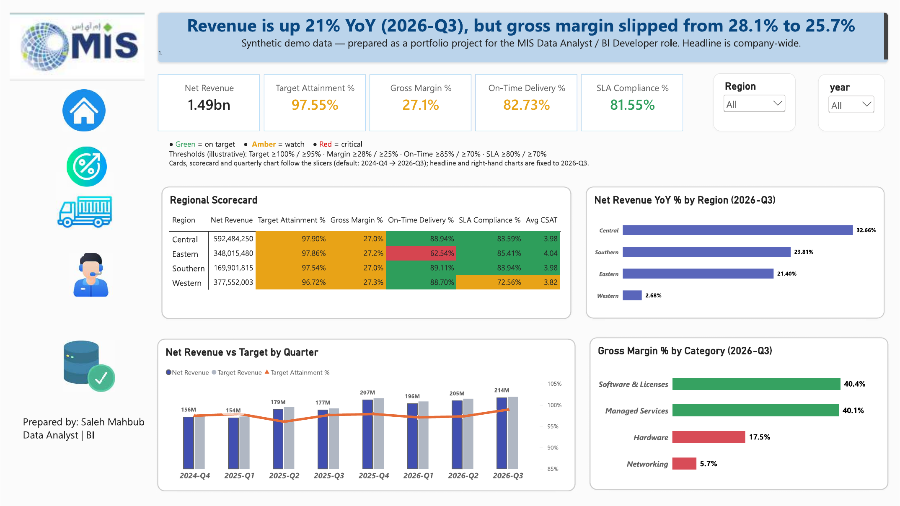
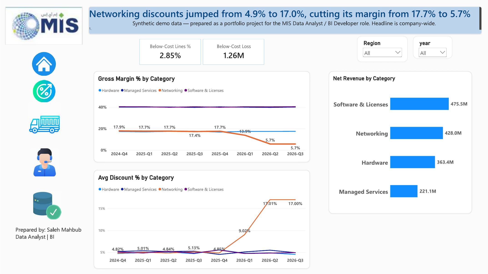
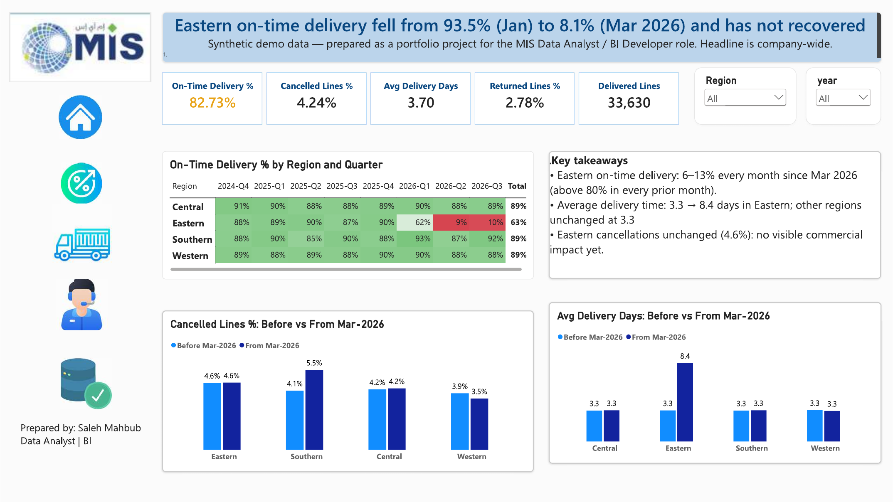
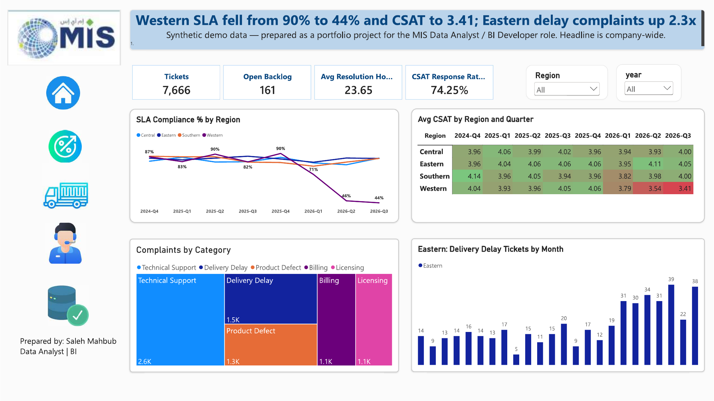
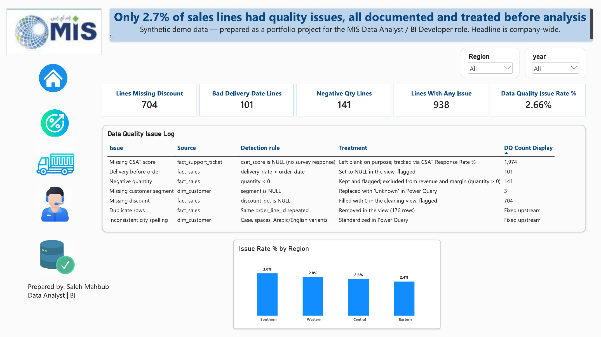
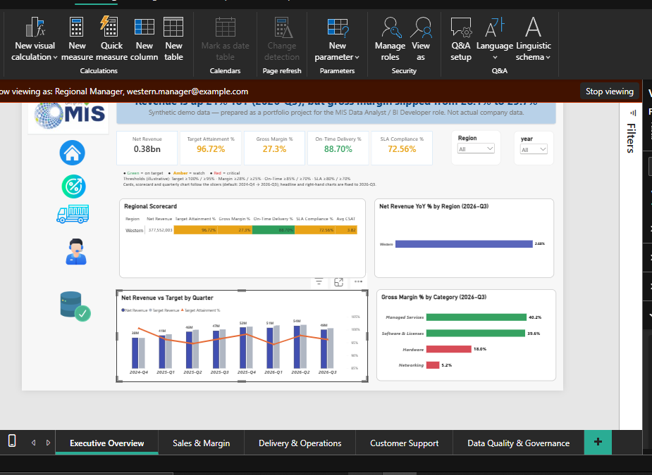
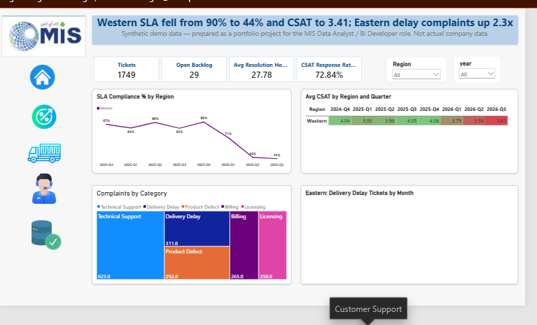
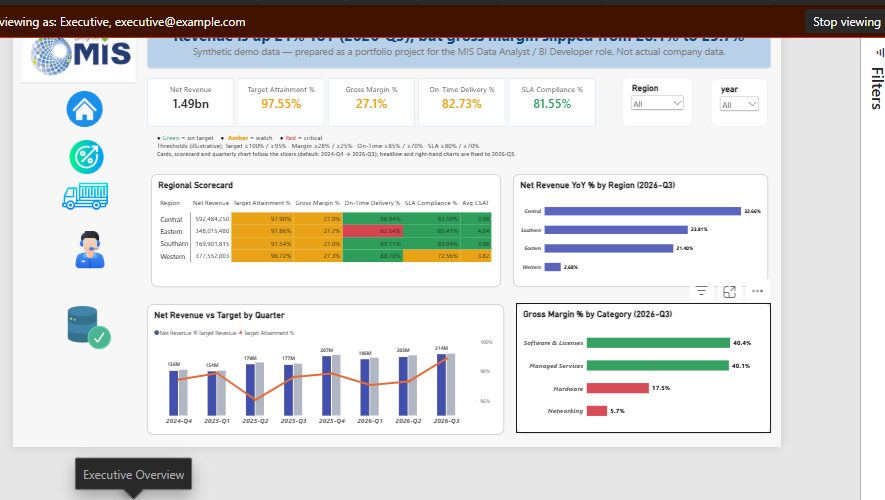
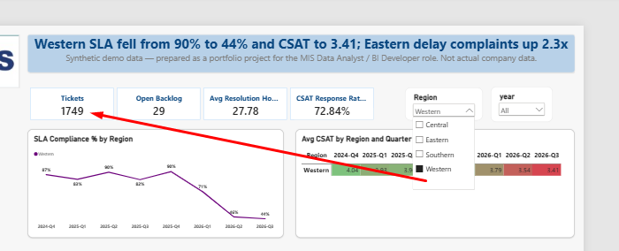

<div dir="rtl">

[English version](README.md)

# لوحة أداء أعمال MIS — SQL Server و Power BI

مشروع BI متكامل أُعدّ لوظيفة **محلل بيانات / مطوّر ذكاء أعمال**: طبقة بيانات نظيفة في SQL Server، ونموذج نجمي في Power BI مع 46 مقياس DAX موثّقًا، ولوحة تنفيذية من خمس صفحات، وأمان على مستوى الصفوف (RLS)، وسجل لجودة البيانات.

> **بيانات اصطناعية.** كل البيانات مولَّدة لهذا المشروع الشخصي. "MIS" اسم افتراضي لشركة، ولا يصف المشروع أي جهة حقيقية.



---

## 1. الأسئلة التجارية

| # | السؤال | أين تُجاب |
|---|---|---|
| 1 | هل ننمو، وهل نحقق الهدف؟ | الصفحة 1 – Executive Overview |
| 2 | هل النمو مربح؟ وأين يتسرب الهامش؟ | الصفحة 2 – Sales & Margin |
| 3 | هل التسليم موثوق، وأين يفشل؟ | الصفحة 3 – Delivery & Operations |
| 4 | هل يواكب الدعم الفني الطلب؟ | الصفحة 4 – Customer Support |
| 5 | هل يمكن الوثوق بالأرقام؟ | الصفحة 5 – Data Quality & Governance |

## 2. أهم النتائج

كل الأرقام تحقّقتُ منها باستعلامات SQL مستقلة (انظر `MIS_interview_queries.sql`).

1. **الإيراد ينمو والهامش لا.** بلغ صافي الإيراد 214.2 مليون في 2026-Q3 (+21.0% على أساس سنوي؛ 1.49 مليار للفترة كاملة). انخفض هامش الربح الإجمالي من 28.1% (2024-Q4) إلى 25.7% (2026-Q3).
2. **مشكلة الهامش في فئة واحدة: Networking.** ارتفع متوسط خصم Networking من 4.85% (2025-Q4) إلى 17.0%، وهبط هامشها الإجمالي من 17.7% إلى 5.7%. تمثّل Networking نحو 28.8% من الإيراد (428.0 مليون من 1,488.0 مليون). أما Hardware فقريب من 17.5% في كل الأرباع، فهامشه المنخفض بنيوي وليس مشكلة جديدة. وبدون Networking يبقى الهامش ثابتًا.
3. **انهار التسليم في المنطقة الشرقية منذ مارس 2026 ولم يتعافَ.** نسبة التسليم في الوقت: 93.5% (يناير) ← 83.4% (فبراير) ← 8.1% (مارس)، ثم 6–13% شهريًا حتى سبتمبر. متوسط زمن التسليم في الشرقية ارتفع من 3.3 إلى 8.4 يوم، بينما بقيت المناطق الأخرى قرب 3.3. وارتفعت تذاكر التأخير في الشرقية من 13.7 إلى 32.1 شهريًا (×2.3).
4. **لا أثر تجاري ظاهر في الشرقية حتى الآن.** نسبة الإلغاء في الشرقية لم تتغير (4.6% قبل وبعد). هذا مؤشر خطر مبكر وليس خسارة محققة.
5. **تدهور الدعم الفني في المنطقة الغربية بحدّة.** انخفض الالتزام بـ SLA من 90.4% (2025-Q4) إلى 43.8% (2026-Q3)، ومتوسط رضا العملاء CSAT من 4.06 إلى 3.41.
6. **نمو الغربية توقف:** +2.7% سنويًا مقابل +21% إلى +33% في المناطق الأخرى.

ما **لا** تُظهره البيانات: *لماذا* حدثت هذه التغيرات. هي أنماط تستحق التحقيق (سياسة التسعير، تغيّر شركة الشحن أو اللوجستيات في الشرقية، التوظيف في الغربية) وليست أسبابًا مثبتة.

## 3. صفحات اللوحة

| الصفحة | العنوان الرئيسي (بالإنجليزية كما في اللوحة) | معاينة |
|---|---|---|
| 1. Executive Overview | Revenue is up 21% YoY (2026-Q3), but gross margin slipped from 28.1% to 25.7% |  |
| 2. Sales & Margin | Networking discounts jumped from 4.9% to 17.0%, cutting its margin from 17.7% to 5.7% |  |
| 3. Delivery & Operations | Eastern on-time delivery fell from 93.5% (Jan) to 8.1% (Mar 2026) and has not recovered |  |
| 4. Customer Support | Western SLA fell from 90% to 44% and CSAT to 3.41; Eastern delay complaints up 2.3x |  |
| 5. Data Quality & Governance | Only 2.7% of sales lines had quality issues, all documented and treated before analysis |  |

قرارات التصميم: عنوان واحد لكل صفحة يذكر النتيجة؛ ألوان الحالة (أخضر / كهرماني / أحمر) تتحكم بها مقاييس DAX؛ نوع الرسم يناسب السؤال (اتجاه = خط، مقارنة = أعمدة، منطقة × زمن = heatmap، تركيبة = treemap)؛ ولا يتكرر نوع الرسم في الصفحة الواحدة.

## 4. البنية

```
بيانات اصطناعية  ←  SQL Server (MIS_BI)  ←  Views للتنظيف  ←  Power BI (Import)  ←  لوحة + RLS
                    جداول حقائق وأبعاد       vw_fact_sales_clean   نموذج نجمي          5 صفحات
                                             vw_sales_enriched     46 مقياس DAX
```

**طبقة SQL**
- `vw_fact_sales_clean` – طبقة التنظيف: تحذف 176 صفًا مكررًا، وتحوّل تواريخ التسليم غير الصحيحة (التسليم قبل الطلب) إلى NULL، وتملأ الخصم المفقود بصفر مع وسمه. الناتج: 35,225 سطر مبيعات.
- `vw_sales_enriched` – view للتحليل يربط المنتج والفئة والفرع والمنطقة والتاريخ، لتحليل SQL ولمطابقة نتائج DAX.
- `MIS_interview_queries.sql` – الأسئلة التجارية بلغة SQL (CTEs، window functions، joins) مع فحوص جودة البيانات.

**نموذج Power BI**
- الجداول: `vw_fact_sales_clean` (حقائق المبيعات عبر view التنظيف)، `fact_support_ticket`، `fact_target_monthly`، وأبعاد التاريخ والمنطقة والفرع والمنتج والفئة الفرعية والفئة والعميل ومندوب المبيعات.
- `dim_date` له علاقة **نشطة** على تاريخ الطلب وأخرى **غير نشطة** على تاريخ التسليم، تُستخدم عبر `USERELATIONSHIP` في مقاييس التسليم.
- المقاييس في جدول مخصص `_Measures`، مرتبة في مجلدات عرض: Sales وTarget وTime Intelligence وOperations وProfitability Risk وSupport وData Quality، إضافة إلى مجلد Formatting لمقاييس ألوان الحالة.
- يوثّق `MIS_DAX_Measures.md` المقاييس الـ 46 الأساسية: النوع والسؤال التجاري والتنسيق والكود. (الكتالوج مكتوب بالعربية. مقاييس ألوان الحالة ومقاييس سجل جودة البيانات أُضيفت لاحقًا وليست فيه بعد.)

## 5. مؤشرات الأداء

| المؤشر | القيمة (الفترة كاملة) | قاعدة الحالة (توضيحية) |
|---|---|---|
| Net Revenue | 1.49 مليار | – |
| Target Attainment % | 97.55% | أخضر ≥ 100%، كهرماني ≥ 95% |
| Gross Margin % | 27.1% | أخضر ≥ 28%، كهرماني ≥ 25% |
| On-Time Delivery % | 82.73% | أخضر ≥ 85%، كهرماني ≥ 70% |
| SLA Compliance % | 81.55% | أخضر ≥ 80%، كهرماني ≥ 70% |
| Avg CSAT | حسب المنطقة | أخضر ≥ 3.9، كهرماني ≥ 3.7 |

الحدود توضيحية وموسومة كذلك على اللوحة. في تطبيق حقيقي تُؤخذ من أهداف الأعمال المعتمدة.

## 6. جودة البيانات

كل مشكلة تُكتشف بقاعدة، وتُعالج في مكان محدد، وتُدرج في الصفحة 5.

| المشكلة | عدد الصفوف | المعالجة |
|---|---|---|
| خصم مفقود | 704 | يُملأ بصفر في view التنظيف مع وسمه |
| تاريخ تسليم قبل تاريخ الطلب | 101 | يُحوَّل إلى NULL في الـ view مع وسمه |
| كمية سالبة | 141 | تُبقى وتُوسَم؛ تُستبعد من الإيراد والهامش |
| صفوف مكررة | 176 | تُحذف في الـ view |
| تهجئة المدن غير متسقة | – | تُوحَّد في Power Query |
| شريحة العميل مفقودة | 3 | تُستبدل بـ "Unknown" في Power Query |
| درجة CSAT مفقودة | 1,974 | تُترك فارغة عمدًا (لا استجابة للاستبيان) |

إجمالًا، 2.66% من سطور المبيعات فيها مشكلة واحدة على الأقل.

## 7. الأمان على مستوى الصفوف (RLS)

دوران، بُنيا واختُبرا في **Power BI Desktop** عبر *Modeling ← View as*.

| الدور | القاعدة | الأثر |
|---|---|---|
| Regional Manager | `dim_region[manager_email] = USERPRINCIPALNAME()` | يرى منطقته فقط، في المبيعات **وتذاكر الدعم** |
| Executive | بلا فلتر | يرى المناطق الأربع |

الاختبارات:

| الاختبار | النتيجة |
|---|---|
| `western.manager@example.com` + Regional Manager، الصفحة 1 | الجدول يعرض Western فقط؛ Net Revenue = 0.38 مليار |
| المستخدم نفسه، صفحة Customer Support | Western فقط؛ 1,749 تذكرة |
| مطابقة: فلتر Region = Western دون RLS | 1,749 تذكرة — مطابق |
| `executive@example.com` + Executive | المناطق الأربع؛ 1.49 مليار؛ 7,666 تذكرة |






## 8. الحدود وملاحظات صريحة

- **غير منشور.** بُني التقرير واختُبر في Power BI Desktop فقط. **لم يُنشر** إلى Power BI Service، فلا يوجد workspace ولا تعيين أعضاء للأدوار ولا تحديث مجدول. في التطبيق الحقيقي يُعيَّن أعضاء RLS في الـ Service، ويحتاج مصدر SQL Server محلي إلى بوابة بيانات (on-premises data gateway) للتحديث المجدول.
- **بيانات اصطناعية.** الأنماط اكتُشفت وتحقّقتُ منها، لكن البيانات لا تفسّر أسبابها.
- **العنوان ثابت.** عنوان كل صفحة نص ثابت يصف الصورة على مستوى الشركة. المستخدم المقيّد بـ RLS يرى منطقته في الرسوم لكن بالعنوان نفسه؛ وسطر الوصف يقول "Headline is company-wide". الحل الصحيح مقياس عنوان ديناميكي.
- **الحدود توضيحية** وليست أهدافًا معتمدة.
- **رسوم بفترة ثابتة.** رسما YoY حسب المنطقة والهامش حسب الفئة في الصفحة 1 مثبّتان على 2026-Q3 ولا يتأثران بفلتر السنة؛ وتذكر ملاحظة الصفحة ذلك.
- **حذر إحصائي.** تغيّر إلغاء الجنوبية من 4.1% إلى 5.5% (≈ 2.5σ). عاملتُه كضجيج محتمل ولم أعرضه كنتيجة.

## 9. محتويات المستودع

| الملف | الغرض |
|---|---|
| `README.md` | الوثيقة الإنجليزية |
| `README.ar.md` | هذه الوثيقة |
| `sql/MIS_interview_queries.sql` | views التنظيف، استعلامات الأسئلة التجارية، فحوص الجودة |
| `powerbi/MIS_DAX_Measures.md` | مقاييس DAX الـ 46 ومعناها التجاري |
| `images/` | صفحات اللوحة ولقطات اختبار RLS |
| `powerbi/MIS_BI_Dashboard.pdf` | التقرير المُصدَّر (5 صفحات) |
| `powerbi/MIS_BI_Analytics.pbix` | تقرير Power BI (افتحه في Power BI Desktop) |
| `html-dashboard/` | لوحة HTML تفاعلية ثنائية اللغة مع مجلد استيعاب تلقائي للملفات (القسم 11) |

## 10. المهارات المُثبتة

SQL Server (views، CTEs، window functions، فحوص الجودة) · نمذجة بيانات Power BI (نموذج نجمي، علاقات نشطة وغير نشطة) · DAX (time intelligence، `CALCULATE`، `USERELATIONSHIP`، `SWITCH`، `DATATABLE`) · تنسيق شرطي بالمقاييس · أمان الصفوف · تصميم KPI · حوكمة جودة البيانات · التحقق من كل مقياس بـ SQL.

## 11. لوحة HTML التفاعلية (ثنائية اللغة مع استيعاب تلقائي)

مخرج ثانٍ على البيانات نفسها: لوحة عربي/إنجليزي (RTL) للإدارة والمديرين والمحللين. ضع ملفات CSV أو XLSX أو JSON في مجلد `inbox/` فتتحدث اللوحة المفتوحة تلقائيًا. أرقامها تطابق تقرير Power BI (قورنت 129 قيمة عبر المناطق والفترات والفئات دون فرق). التفاصيل في [`html-dashboard/README.md`](html-dashboard/README.md) و`html-dashboard/docs/`.

```bash
cd html-dashboard
npm install
npm start        # http://127.0.0.1:8080
```

حدود صريحة: لا مخطط Gantt (البيانات بلا تواريخ مهام)، والخريطة تخطيطية، ولا تسجيل دخول في النموذج الأولي، وملفات `.sql` لا تُنفَّذ أبدًا.

---

*إعداد: صالح محبوب — Data Analyst | BI.*

</div>
